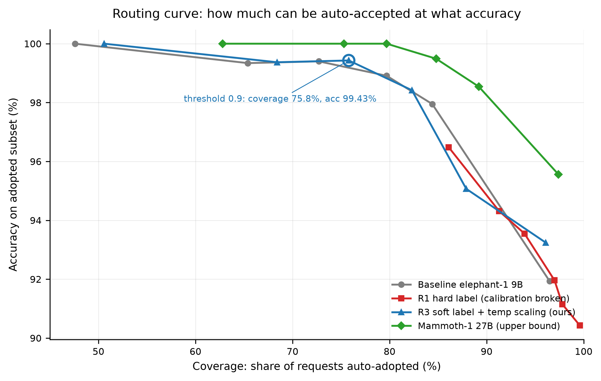
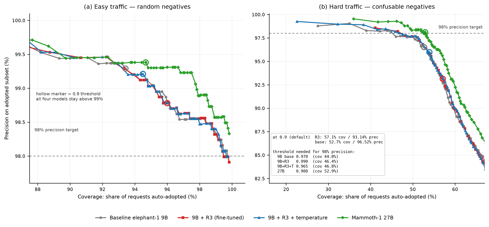

# Decision Model LoRA Adaptation

在 9B 决策模型上做参数高效微调，并从三个层次验证它到底带来了什么：**准确率**、**概率校准**、**跨域泛化**。

**一句话结论**：LoRA 能让 JevBench public-231 的准确率从 208 涨到 210 条，但**只有在用软标签训练时才不破坏校准**；即便如此，置信度在难样本上仍会变得不可靠（0.9 阈值漏放的错误翻 2.1 倍）——这是本项目和"调个 LoRA 涨点"最重要的区别。

> ### ⚠️ 2026-10-30 更正：难负集构造有缺陷，相关结论作废
>
> 难负样本集的构建里，正确类别在选项中以**两种拼写同时出现**（`age_limit` 与 `age limit`），
> 而只有带空格的那个被算作正确。1,200 条里有 **504 条**受影响（banking77 293、clinc150 211）。
> 模型面对的是"同一语义的两个选项"，选另一个就判错——这不是能力差异，是构造错误。
>
> 因此下文所有**难负集**的数字全部作废，包括：准确率 69.42 / 68.92 / 70.42%、ECE 0.1625、
> 高置信错误 22 → 47、采纳精度 96.52% → 93.14%、以及据此做的阈值选点与分层策略。
> 这些需要**重建数据集后重跑**才能重新成立，目前没有重跑（GPU 未占用）。
>

> 影响量化：旧结果里 9B 基线 367 个"错误"有 **315 个**（85.8%）是模型选了正确答案的另一种拼写；
> R3 是 322/373（86.3%），27B 是 315/355（88.7%）。也就是说那套 69–70% 的准确率主要是这个缺陷造成的。
> 构造器已修复：`build_crossbench_hard.py` 改为在 canonical 标签空间里比较与去重，
> 重建后 1,200 条的 gold 重复数为 **0**，难负平均余弦从 0.2357 变为 0.1917
> （去掉别名后选到的是真正不同的类别）。**public-231 与随机负样本集不受此缺陷影响**
> （随机版复用同一套 canonical 检查，gold 重复数为 0）。
>
> 另有一处同类问题：`convert_drop.py` 曾把 `"正确计算结果"` 写进 gold 选项的 criteria 描述，
> 而该描述会被渲染进模型输入，等于标出答案。已改为中性空描述。9B 那轮 DROP 训练子集
> 因此可能学到的是捷径而非算术，相关归因需谨慎。

---

## 结论先行

1. **硬标签训练会把模型训成"过度自信"。** 准确率只涨 1 条，但 ECE 从 0.0338 恶化到 0.0840，高置信却答错的样本从 1 条涨到 14 条，0.99 阈值下只剩 6.6% 的样本能采纳——置信度闸门基本失效。
2. **软标签是减震器，不是发动机。** 它不让模型学得更准，只让它别过度自信。同样的软标签数据，1 epoch 准确率 +0 / ECE 0.0337，2 epoch 准确率 +2 / ECE 0.0549。**训练强度决定准确率，软标签决定校准下限。**
3. **提升是零退步的，而且落在没有投过数据的族上。** R3 相比基线新对 2 条、新错 0 条，两条全在 `multi_hop`——这一族一条训练样本都没投。
4. **跨域 1,200 条上没有可检测的能力退化**（净 −1 条，McNemar p = 1.000），但那套题在随机负样本下饱和（97.8–98.3%），分辨率只有 ±0.8 个点。
5. ~~**换成难负样本后，准确率仍无显著退化（−0.50 个点，p = 0.210），但校准明显变差**：高置信错误 22 → 47，采纳精度 96.52% → 93.14%。~~ **本条作废**——难负集构造有缺陷（见上方更正），需重建重跑。
6. **一个标量温度能修掉整体尺度偏移。** T=1.31 在随机负样本集上把 R3 的 ECE 从 0.0113 压到 0.0071（等于基线 0.0071），高置信错误 14 → 9。这一条**不受难负集缺陷影响**，仍然成立。难负集上"只修掉大半"的说法作废。

---

## 实验逻辑

整个项目分五个阶段，后一阶段的结论依赖前一阶段的方法是否站得住，所以顺序不能换：

```
①  建评测、跑基线            4 个模型 × public-231，同一口径
        ↓                     → 90.04% 起点，27B 上限 93.94%
②  分析错误、审数据          23 条错误拆到 18 个族；94,707 条第三方数据逐项审计
        ↓                     → 弱项集中；69% 数据依赖图像，可用率 0.76%
③  四轮 LoRA 对照            硬标签 / 软标签 × 训练强度
        ↓                     → 准确率与校准的权衡曲线
④  校准与路由                温度缩放 + 0.9 阈值路由
        ↓                     → 置信度能不能用来做闸门
⑤  跨域泛化                  4 个公开数据集 × 2 种难度
                              → 有没有拿通用能力换这 2 条
```

第 ⑤ 步是最后加的，因为前四步全部建立在 231 条上，而 231 条已经被用来拟合温度、挑选 checkpoint。**在同一个集合上既调参又报告，结论会越来越虚**，所以必须有一个从没参与过任何决策的集合来做交叉验证。

---

## 阶段一：基线与评测口径

四个模型、同一套 231 条、同一推理口径、单卡 H100 / bf16 自托管：

| 模型 | 参数量 | 准确率 | Brier | ECE | p50 延迟 |
|---|---:|---:|---:|---:|---:|
| Decider-2B（参照） | 2B | 77.92% | 0.2803 | 0.0752 | 0.133s |
| elephant-1（基线） | 9B | 90.04% | 0.1289 | **0.0338** | 0.149s |
| Mammoth-1（上限参照） | 27B | **93.94%** | **0.0828** | **0.0194** | 0.256s |

差距全部集中在 hard 集：easy 和 original 两个档位 2B 与 27B 都是满分，**hard 档 58.6% → 87.4%**。只报总分会让差距看起来均匀分布，实际不是。

---

## 阶段二：数据审出三个坑

用 OneJev-Data（94,707 条）当候选池，先审后训。三个发现直接改变了方案：

| 问题 | 实测 | 后果 |
|---|---|---|
| 图像依赖 | **30.69% 纯文本**，其余 69% 带 media 引用 | 纯文本模型不可用，直接排除 |
| 标签可信度 | 纯文本子集里 42% 是 LLM 蒸馏（Qwen3.5-27B / DeepSeek），`human` 只有 3 条 | 只能保留 program 验证类 |
| 长度错位 | 筛后 state 中位数 **3,815 字符**，JevBench 只有 **70 字符** | 训练"长轨迹"去评"短场景"，分布是反的 |

全量筛选后只剩 **717 条（0.76%）**。这个数字击穿了"字段名相同就能训练"的假设——按独立概率相乘我原来估的是 10,800 条，实际差一个数量级，因为各条件高度重叠。

最终配比改为：When2Call（工具决策，短场景，与评测长度对齐）+ DROP（数值推理）+ OneJev-Data（补充），**按弱项错误占比配比，而不是按数据可得性**。

一个反例值得记住：把 When2Call 和 OneJev 直接拼起来是 6,601 条，其中 **98.6% 的训练量砸在 `tool_selection` 和 `routing` 上，而这两族模型本来就是 24 题全对**；真正错的三个族一条数据没有。按那个配比训练，最好结果是总分不动、校准变差。

---

## 阶段三：四轮 LoRA 对照

全部在 public-231 上评测，同一套数据、同一推理口径。

| 模型 | 准确率 | 对题 | Brier | ECE | 训练配置 |
|---|---:|---:|---:|---:|---|
| elephant-1 基线 | 90.04% | 208 | 0.1289 | **0.0338** | 官方权重 |
| R1 | 90.48% | 209 | 0.1724 | 0.0840 | 硬标签 / 2ep / lr 1e-4 |
| R2 | 90.04% | 208 | 0.1369 | 0.0337 | 软标签 / 1ep / lr 1e-5 |
| R3 | 90.91% | **210** | 0.1395 | 0.0549 | 软标签 / 2ep / lr 1e-5 |
| **R3 + 温度缩放** | **90.91%** | **210** | 0.1346 | 0.0502 | + T=1.31 |
| Mammoth-1 27B | 93.94% | 217 | 0.0828 | 0.0194 | 官方权重 |

可训练参数 **7.86M / 8,961.67M = 0.088%**，只打在 `q/k/v/o_proj` 上，训练峰值显存 **18.0 GB**。

**软标签怎么来的**：用基线模型对 1,166 条训练样本逐条打分，`teacher 对 → 0.8×one-hot + 0.2×teacher_dist`，`teacher 错 → 保持 one-hot`（错误分布不可信，不能学）。这里有个值得记的数字：**基线在训练集上只有 62.3% 正确**，远低于它在 JevBench 上的 90%——DROP 的数值题和 When2Call 的工具决策对它明显更难。

---

## 阶段四：校准与路由

这是本项目的主线指标。决策模型的价值一半在准确率，一半在"它知道自己有多确定"。

0.9 阈值下直接采纳（231 条）：

| 模型 | 采纳条数 | 覆盖率 | 采纳精度 | 其中错 |
|---|---:|---:|---:|---:|
| Decider-2B | 82 | 35.5% | 100% | 0 |
| elephant-1 基线 | 168 | 72.7% | 99.40% | 1 |
| R1（硬标签） | 217 | 93.9% | **93.55%** | **14** |
| R2（软标签 1ep） | 185 | 80.1% | 98.38% | 3 |
| **R3 + 温度** | **175** | **75.8%** | **99.43%** | **1** |
| Mammoth-1 27B | 184 | 79.7% | 100% | 0 |

R3+温度在**保持 99.4% 采纳精度的前提下多采纳 7 条**，错误数与基线持平。R1 是反面教材：它敢说"我确定"的样本占了 93.9%，其中 14 条是错的。



完整的阈值-覆盖率曲线见 [`results/routing_curve.csv`](results/routing_curve.csv)。

**温度本身是个诊断指标**：基线 0.97（本来就校准得好）、R1 2.23（严重过度自信）、R3 1.31。对已校准的模型再拟合一次得到 **T = 1.000**，这是"校准真的写进去了"最干净的验证。

一处必须说清的张力：**R3+温度的 ECE（0.0502）仍高于基线（0.0338），但路由表现更好。** 这两个结论并存，原因是 ECE 是全局平均、路由只看高置信区间。不应只引用后者。

---

## 阶段五：跨域泛化

public-231 已被用于拟合温度和挑选 checkpoint，继续在它上面调分等于测试集调参（jevbench README 明确要求披露：*Training on the public split must be disclosed.*）。因此另建 **1,200 条独立评测**，数据与训练配比零交集。

四个数据集，各 300 条：`banking77`（意图路由）、`clinc150`（意图路由）、`ai2_arc`（科学推理）、`imdb`（长文本）。选项顺序打乱，按类别平衡采样。

### 5.1 随机负样本版：饱和了

| 模型 | 准确率 | gold 概率 | NLL | ≥0.9 覆盖 | 高置信错误 |
|---|---:|---:|---:|---:|---:|
| 9B 基线 | 97.92% | 0.9631 | 0.0737 | 93.4% | 8 |
| 9B + R3 | 97.83% | 0.9714 | 0.0779 | 96.0% | 14 |
| 9B + R3 + T | 97.83% | 0.9638 | **0.0735** | 94.5% | 9 |
| 27B | **98.33%** | 0.9715 | **0.0597** | 94.7% | 7 |

- **没有可检测的退化**：净 −1/1200，McNemar p = 1.000。但基线 97.92%、二项标准误 0.41 个点，**只能排除大于 0.8 个点的损伤**。
- **27B 的优势从 +3.9 个点缩到 +0.42 个点**——不是 27B 变弱，是题太简单，三代模型都顶到 98% 附近。
- 唯一保留区分度的是 NLL（0.0597 vs 0.0737）。
- 一个反直觉的细节：27B 在 IMDB 上**反而比 9B 低 0.67 个点**，长文本二分类不吃规模。

### 5.2 难负样本版：把分辨率找回来

> **⚠️ 本节结论已作废（2026-10-30）**
>
> 难负集构造有缺陷：正确类别以 `age_limit` 与 `age limit` 两种拼写同时出现在选项里，
> 只有一种被算作正确。1,200 条中 **504 条**受影响。模型选到另一个拼写就被判错，
> 这是构造错误而非能力差异。
>
> 下方所有数字（69.42 / 68.92 / 70.42%、ECE 0.1625、高置信错误 22→47、
> 采纳精度 96.52%→93.14%，以及据此做的阈值与分层策略）**在重建并重跑之前不应引用**。
> 构造器已修复（改用 canonical 标签比较），重建后 1,200 条 gold 重复数为 0，
> 难负平均余弦 0.2357 → 0.1917。**重跑尚未进行**（未占 GPU）。

随机负样本让意图任务失去意义（98.67% / 99.33%）。改法很克制：**查询、正确标签、选项数全部不动，只把 7 个干扰项换成 TF-IDF 最相似的意图**。这样两组差值隔离出"负样本难度"一个变量，task id 一致，可逐题配对。

| 数据集 | 随机-9B | 难负-9B | 随机-27B | 难负-27B |
|---|---:|---:|---:|---:|
| banking77 | 98.67% | **30.33%** | 99.00% | **33.00%** |
| clinc150 | 99.33% | **53.67%** | 99.33% | 53.67% |
| ai2_arc | 97.00% | 97.00% | 99.00% | 99.00% |
| imdb | 96.67% | 96.67% | 96.00% | 96.00% |

难负的相似度是随机版的 **5.0 倍（banking77）/ 12.2 倍（clinc150）**。查询"怎么激活卡片"，干扰项从 `top up by bank transfer charge` 变成 `card not working`、`card linking`、`card acceptance`、`order physical card`。

**这套题测的是真能力，不是标注噪声**：难负集上 **91.6% 的错误**是"选了一个与正确答案共享实词的邻近意图"，随机集上只有 20%。

| 模型 | 准确率 | ECE | NLL | ≥0.9 覆盖 | 采纳精度 | 高置信错误 |
|---|---:|---:|---:|---:|---:|---:|
| 9B 基线 | 69.42% | **0.1272** | 0.5481 | 52.7% | **96.52%** | **22** |
| 9B + R3 | 68.92% | 0.1625 | 0.6185 | 57.1% | 93.14% | **47** |
| 27B | **70.42%** | **0.1171** | **0.4803** | 52.9% | **98.11%** | **12** |

难度一上来，所有差异放大 2–8 倍：27B 领先 +0.42 → **+1.00**；R3 的 ECE 相对基线 +0.0042 → **+0.0353**；R3 的高置信错误 14 → **47**（基线 22）。

**结论分两层：**

- **准确率上没有显著退化。** R3 净 −6 条，McNemar **p = 0.210**。失分集中在两个意图族（6 + 4 条），得分也在这两族（2 + 2），不是系统性崩塌。
- **置信度上明显退化，而且恰好发生在最需要它的地方。** 输入越难，R3 的置信度越不可信；而路由的价值正在于判断难样本。

### 5.3 温度跨域迁移

| 集合 | R3 ECE | +T=1.31 | 基线 ECE | R3 高置信错误 | +T | 基线 |
|---|---:|---:|---:|---:|---:|---:|
| 随机负 | 0.0113 | **0.0071** | 0.0071 | 14 | **9** | 8 |
| 难负 | 0.1625 | **0.1345** | 0.1272 | 47 | **26** | 22 |

随机集上完全修平（ECE 追平基线）。难负集上能压掉大半但**修不干净**（0.1345 vs 0.1272，26 vs 22 条）。

所以过度自信有两个成分：**整体尺度偏移**（一个标量就能修）和**难样本上的局部过度自信**（标量修不了，需要按难度分层校准，或者换更强的底座）。

---

## 对落地的影响：怎么调阈值

> **⚠️ 本节（阈值表）结论已作废（2026-10-30）**
>
> 难负集构造有缺陷：正确类别以 `age_limit` 与 `age limit` 两种拼写同时出现在选项里，
> 只有一种被算作正确。1,200 条中 504 条受影响。模型选到另一个拼写就被判错，
> 这是构造错误而非能力差异。
>
> 下方所有数字（69.42 / 68.92 / 70.42%、ECE 0.1625、高置信错误 22→47、
> 采纳精度 96.52%→93.14%、阈值与分层策略）**在重建并重跑之前不应引用**。
> 构造器已修复（改用 canonical 标签比较），重建后 1,200 条 gold 重复数为 0，
> 难负平均余弦 0.2357 → 0.1917。**重跑尚未进行。**


拿 R3 做置信度路由，**不能沿用同一个阈值跨流量**。为达到目标采纳精度所需的最低阈值（实测自 1,200 条难负集）：

| 流量 | 模型 | 0.9 阈值下 | 达 98% 精度需 | 该阈值覆盖 | 达 99% 精度需 |
|---|---|---|---|---|---|
| 简单 | 9B 基线 | 93.4% / 99.29% | 0.505 | 99.7% | 0.845 |
| 简单 | 9B+R3+T | 94.5% / 99.21% | 0.535 | 99.6% | 0.865 |
| **难** | 9B 基线 | 52.7% / **96.52%** | **0.970** | 44.8% | 0.990 |
| **难** | 9B+R3 | 57.1% / **93.14%** | **0.990** | 46.4% | **不可达** |
| **难** | 9B+R3+T | 53.9% / 95.98% | 0.965 | 46.8% | 0.995 |
| **难** | 27B | 52.9% / **98.11%** | 0.900 | 52.9% | 0.975 |

（每格是「覆盖率 / 采纳精度」）



左图简单流量：四条曲线都贴在 99% 以上，0.9 随便用。右图难流量：同样的 0.9，R3 掉到 93.14%，要保住 98% 得把阈值推到 0.99。两个面板的横轴范围不同，不要跨面板比水平位置。

三条操作要点：

**1. 简单流量：0.9 直接可用。** R3+温度覆盖率 94.5%、采纳精度 99.21%，与基线持平略优。

**2. 难流量：0.9 会让 2.1 倍的错误通过。** R3 采纳精度 93.14%（基线 96.52%），要高到 98% 得把阈值从 0.9 提到 **0.990**，代价是覆盖率从 57.1% 掉到 46.4%。

**3. 达到 99% 时，R3 在难流量上不存在可用工作点**——任何阈值都达不到，基线可以（0.990 / 35.0%）。**这是"阈值没调对"与"模型不达标"的分界**：前者调参可解，后者只能换模型或重训。

### 分层阈值：用 margin 当难度探针

不需要标签也能在推理时判断"这条难不难"：取 top-1 与 top-2 的概率差（margin）。按中位数分两层后，**低 margin 半区的错题率 58.50%，高 margin 半区只有 2.67%，相差 21.9 倍**（27B 上 34.5 倍）。

于是可以让难样本走更高的门槛：

| 策略（低 margin / 高 margin 阈值） | 覆盖率 | 采纳精度 | 采纳中出错 |
|---|---:|---:|---:|
| 0.90 / 0.90（不分层，即默认） | 57.1% | 93.14% | 47 |
| 0.95 / 0.90 | 54.0% | 95.83% | 27 |
| **0.99 / 0.95** | **50.0%** | **97.50%** | **15** |

代价是少采纳约 7 个百分点，换来精度回到可用区间（基线默认是 52.7% / 96.52% / 22 错）。

### 上线流程建议

1. **先定目标精度，再反解阈值**——不要先设 0.9 再看精度，那样无法回答"够不够"。
2. **微调后必须重估阈值**：基线在 0.9 上勉强可用（96.52%），微调版同阈值只有 93.14%，沿用旧阈值等于静默降质。
3. **按流量分层，不要一个全局阈值**：简单流量 0.9，难流量按上表选点，或用 margin 分层。
4. **区分阈值问题与模型问题**：目标精度在任何阈值下都达不到时，调参无用。

---

## 与 Jev 及同生态模型的关系

**Jev 本身没有公开权重，也没有公开参数量。** 它是 TypeSafe AI 的闭源旗舰模型（`jev-1.13.0` / `jev-1.14.0`），只通过 `POST https://api.typesafe.ai/v1/systemone` 提供服务。

更关键的是：官方文档明确说明 **Jev 不接受针对客户数据的微调或 LoRA 适配**（"not fine-tuned or LoRA-adapted with customer data, the same weights serve every account"）。所以如果目标是"微调决策模型"，Jev 从设计上就不是候选。

本项目用的都是同范式的开源复现：

| 模型 | 参数量 | 权重 | 可否微调 | Jev Decision Index |
|---|---|---:|---|---:|
| **Jev 1.14**（TypeSafe AI） | **未公开** | 闭源 | **否**（官方声明） | 60.2 |
| Mammoth-1（Baset Labs） | 27B | 开源 | 是 | 71.24（v0.4） |
| **Elephant-1（Baset Labs）** | **9B** | 开源 | 是（本项目） | — |
| OneJev1.5-27B（OmniJev） | 27B | 开源 | 是 | 59.9 |
| OneJev1.5-9B | 9B | 开源 | 是 | 53.3 |
| OneJev1.5-4B | 4B | 开源 | 是 | 49.2 |
| OneJev1.5-0.8B | 0.8B | 开源 | 是 | 29.0 |
| Strands Decider 2B | 2B | 开源 | 是 | 20.7 |

> Jev Decision Index 是 37 个 benchmark 的综合分，**与本文的 public-231 准确率不是同一口径**，两列数字不可直接比较。分数取自该榜单 2026-10 快照。

两个观察：闭源 Jev 的 60.2 分低于多个开源 27B（Fastino GLiDE 71.5、Lychee-27B 67.3），它的价值在服务与 RLCD 训练流程而非参数规模；规模与分数大致单调（0.8B 29.0 → 27B 59.9）。

顺带一个值得注意的生态信号：JevBench 官方榜单 v1.4.2.1 的第一名是 **Plumb-4B（JevK5 v0.2 + LoRA）65.84 分**，排在 Jev 1.13（63.29）之前——"LoRA 微调决策模型"这条路不仅可行，已经有人靠它登顶。

---

## 仓库结构

```
├── README.md
├── requirements.txt
├── data_tasks.jsonl              # 231 条任务的 family / tier 元信息
├── docs/                          # 实验文档（按阶段顺序）
│   ├── tech-report.docx           # 技术报告（可直接提交）
│   ├── 01-data-schema-audit.md    # 第三方数据集 schema 审计
│   ├── 02-decontamination.md      # 与评测集的污染检查
│   ├── 03-trainer-compatibility.md# 训练器字段/损失/注意力核对
│   ├── 04-targeted-data-mix.md    # 定向数据配比评估
│   ├── 05-round1-hard-label.md    # 第一轮：硬标签，校准崩坏
│   ├── 06-round2-soft-label.md    # 第二轮：软标签 + 温度缩放
│   ├── 07-conclusion-and-next.md  # 结论与后续方案
│   ├── 08-baseline-four-models.md # 四个基座模型的横评
│   ├── 09-crossbench.md           # 跨 benchmark 泛化（随机负样本）
│   ├── 10-crossbench-hard.md      # 跨 benchmark 泛化（难负样本）
│   └── figures/                   # routing_curve.png / threshold_curves.png
├── src/
│   ├── eval/                      # 评测集构建与结果分析
│   ├── data/                      # 审计、去污染、格式转换、跨域集构建
│   ├── train/                     # adapter 合并
│   ├── serve/                     # 决策模型 HTTP 服务封装
│   └── analysis/                  # 汇总、校准拟合、路由分析、跨域分析
├── scripts/                       # 环境准备与自动化流水线
└── results/
    ├── summary_all_models.csv     # 8 个模型在 231 条上的横向对比
    ├── per_family.csv             # 18 个任务族的准确率
    ├── routing_curve.csv          # 阈值-覆盖率-准确率
    ├── calibration_study.json     # 温度拟合结果
    ├── crossbench/                # 跨域（随机负样本）：1,200 条任务 + 三模型逐题结果
    ├── crossbench_hard/           # 跨域（难负样本）：同上，两套对照分析
    └── <run>/                     # 每次运行的 per-example 结果
```

---

## 环境要求

- Python 3.11
- PyTorch 2.8.0 + CUDA 12.8（H100 上验证）
- 单卡 H100 80GB（9B LoRA 训练峰值 **18.0 GB**，27B 推理约 **55 GB**）
- 决策模型 runtime：[OneJev](https://github.com/OmniJev/OneJev) @ `81ce62f`

```bash
pip install -r requirements.txt
pip install -e OneJev[train]        # 含 qev runtime
```

---

## 复现步骤

**1. 准备模型**

```bash
bash scripts/prep_baselabs.sh                                    # 拉镜像、下载 9B 权重
bash scripts/dl_mammoth.sh                                       # 可选：27B
bash models/elephant-1/setup.sh /path/to/workdir                 # 注意：脚本不会自动创建 workdir
```

**2. 起服务**

```bash
python src/serve/serve_baseten.py --model models/elephant-1 --port 8100
```

**3. 跑基线评测**

```bash
jevbench run --tasks data/jevbench_public_231.jsonl \
  --adapter typesafe --endpoint http://127.0.0.1:8100 \
  --model elephant-1 --key-env= --cost-basis no_billable_local_selfhost --reserve-usd 0 \
  --results results/elephant1_base/results.jsonl --raw-dir results/elephant1_base/raw \
  --ledger results/elephant1_base/ledger.jsonl --manifest results/elephant1_base/manifest.json
```

**4. 构造训练数据（含去污染）**

```bash
python src/data/onejev_audit.py            # schema 与分布审计
python src/data/decontaminate.py           # 与 231 条比对，确认零重合
python src/data/build_train_jsonl.py       # 筛选 + 去重 + source-level 划分
python src/data/convert_when2call.py       # 工具决策数据转决策格式
python src/data/convert_drop.py            # 数值题转 choice（含干扰项构造）
python src/data/build_round1.py            # 按弱项配比拼装
python src/data/make_soft_labels.py        # 用 teacher 输出分布生成软标签
```

**5. 训练**

```bash
torchrun --nproc-per-node 1 -m train.sft \
  --model models/elephant-1 \
  --train data/round2/train_soft.jsonl \
  --name r3_soft_2ep \
  --attention noncausal --readout slot_lm \
  --lora-r 32 --lora-alpha 64 --lora-dropout 0.05 \
  --target-modules q_proj,k_proj,v_proj,o_proj \
  --max-len 4096 --batch-tokens 2048 \
  --epochs 2 --lr 1e-5 --brier-weight 1.0
```

**6. 合并 + 校准 + 评测**

```bash
python src/train/merge_adapter.py --adapter <run>/adapter --out models/elephant-1-r3
python src/analysis/fit_calibration_and_routing.py     # 拟合温度、输出路由曲线
python src/analysis/collect_results.py                 # 汇总所有 run
```

**7. 跨域泛化（两套难度）**

```bash
python src/data/build_crossbench.py         # 1,200 条，随机负样本
python src/data/build_crossbench_hard.py    # 换成 TF-IDF 最相似意图作为干扰项
bash scripts/run_hard_eval.sh <容器> <模型路径> <运行名> <端口>
python src/analysis/analyze_crossbench.py
python src/analysis/compare_hard_vs_random.py
python src/analysis/threshold_advice.py     # 目标精度 → 所需阈值 → 覆盖率代价
python src/analysis/margin_difficulty.py    # margin 作为难度探针 + 分层阈值策略
```

---

## 四个真实踩过的坑

**1. `--attention` 默认是 `causal`，直接用会毁掉模型架构。**

`elephant-1` 用的是 block-bidirectional attention（`config.json` 里的 `modeling_overrides.attention.full_attention = "block_bidirectional"`）。推理时引擎会读这个字段，但**训练器 `train/sft.py` 用命令行参数直接构造 `ReadoutConfig`，不读它**。不加 `--attention noncausal` 就等于先把架构改残再训练。

**2. fla + Triton 3.4.x 在 Hopper 上会静默算错梯度。**

```
RuntimeError: Triton >= 3.4.0 and < 3.7.1 on Hopper GPUs produces incorrect results
for gated chunk_bwd_dqkwg
```

Qwen3.5 系列的 gated delta rule 依赖 `flash-linear-attention`。这个版本区间下反向 kernel 算出的梯度是错的但程序不报错——是库自己主动 raise 才挡住。解法：`pip install tilelang`，fla 会自动切后端（`[FLA Backend] chunk_bwd_dqkwg -> tilelang`）。

**3. 第三方 parquet 数据集里的 `question`/`target` 是 JSON 字符串，不是对象。**

训练器 `render_example` 直接对 `row["question"]` 调 `.get("type")`，不做解析就一定 AttributeError。所有外部数据在入训前必须 `json.loads` 再写回 JSONL。

**4. 合并 LoRA 时 `readout.json` 必须一起带走。**

adapter 目录里的 `readout.json` 记录了训练时的 `attention=noncausal`。如果合并时漏掉，推理会用默认的 causal，评测结果全部无意义。

---

## 数据说明

| 来源 | 用途 | 许可 | 备注 |
|---|---|---|---|
| [JevBench](https://github.com/OmniJev/jevbench) public-231 | 评测 | 见仓库 | 231 条，全部为官方原创场景 |
| [OneJev-Data](https://huggingface.co/datasets/OmniJev/OneJev-Data) | 训练（补充） | 逐条不同 | 94,707 条；严格筛选后仅 717 条可用（0.76%），**69% 依赖图像** |
| [When2Call](https://huggingface.co/datasets/nvidia/When2Call) | 训练（工具决策） | CC-BY-4.0 | 用 `train_pref` 而非 `train_sft`（后者 15,000 条里没有一条工具调用样本） |
| [DROP](https://huggingface.co/datasets/ucinlp/drop) | 训练（数值推理） | CC-BY-4.0 | 只转纯数值答案，干扰项从同 passage 取同量级数字 |
| [banking77](https://huggingface.co/datasets/PolyAI/banking77) / [clinc150](https://huggingface.co/datasets/clinc/clinc_oos) | 跨域评测 | CC-BY | 8 选 1 构造集，绝对值不可比文献 |
| [ai2_arc](https://huggingface.co/datasets/allenai/ai2_arc) / [imdb](https://huggingface.co/datasets/stanfordnlp/imdb) | 跨域评测 | CC-BY-SA / Apache | 原生选项 / 长文本二分类 |

**污染检查**：OneJev-Data 全量 94,707 条与 public-231 做 exact / normalized / source / task 四层比对，**六项重合全部为 0**。原因是 231 条全部为官方原创 authored scenario，与公开数据集不同源。语义近似（Level 3）未做。

跨域那四个数据集与训练配比零交集（训练用的是 OneJev-Data / When2Call / DROP），所以基线 vs R3 的差异是纯迁移效果。但它们本身可能在底座模型的训练数据里，**绝对水平可能被高估，模型间的差值是干净的**。

---

## 评测范围（重要）

JevBench 的公开 manifest 共 7 个 split、425 条：

| split | 条数 | 本仓库 | 说明 |
|---|---:|---|---|
| easy | 48 | ✅ 已用 | 随仓库分发 |
| original | 72 | ✅ 已用 | 随仓库分发 |
| hard | 111 | ✅ 已用 | 随仓库分发 |
| heldout | 24 | ❌ 封存 | 只有 sha256，不含正文 |
| router | 78 | ❌ 封存 | 同上 |
| judge | 68 | ❌ 封存 | 同上 |
| easy-heldout | 24 | ❌ 封存 | 同上 |

**JevBench 相关数字只覆盖 231/425（54%）的公开可跑部分。** 其余 194 条与官方另外 308 条 sealed 决策题不对外分发；完整评测需向 Benchmark Heaven 提交模型。

两条合规要求（引自 jevbench README）：

1. **"Training on the public split must be disclosed."** 本项目的训练数据与这 231 条做过四层去污染（六项重合为 0），但**用这 231 条拟合了温度参数、并用它挑选 checkpoint**，按此要求披露。
2. **"A leaderboard score does not establish reliability on your workload."** 单一 benchmark 的分数不能外推——这也是阶段五存在的原因。

---

## 局限性（诚实清单）

1. **温度是在 public-231 上拟合的**，属于测试集调参（1 个自由度）。ECE 0.0502 应理解为上界，正式结论需要独立校准集。
2. **训练数据只有 1,166 条**，是同模型原始训练量的 0.02%。+2 条的提升统计意义有限。
3. **R3 的 ECE 仍高于基线**（JevBench 上 0.0502 vs 0.0338；难负集上 0.1625 vs 0.1272）。路由曲线更好与全局校准更差这两个结论并存，不应只引用前者。
4. **训练集与评测集分布不同**：训练是工具决策 + 数值题 + agent 轨迹判断，评测是 18 个族的通用决策。
5. 路由表在 0.9 阈值下只有 175 条样本，置信区间宽，不应过度解读千分位差异。
6. 27B 的延迟（p50 0.256s）是在独占卡上测的，9B 各组在共享卡上测，延迟数字不完全可比。
7. **跨域随机负样本版已饱和**：三代模型都在 97.8–98.3%，分辨率只到 ±0.8 个点。
8. **难负版 banking77 掉到 30.33% 偏低**（8 选 1 随机基线 12.5%），接近"过难"边缘。想拿中间难度可混 4 个难负 + 3 个随机负，预计落在 55–70%。
9. **难负由 TF-IDF 选，不是语义相似度**：词面近而语义远的意图会被选进来，理论上引入少量"其实不难"的干扰项。
10. **clinc150 上三代模型都是 53–54%**，没有区分度，怀疑该族难负集中在同一 domain 内互相干扰。
11. **跨域绝对值不可比文献**：8 选 1 是构造协议，不是原生 77/150 类全标签空间。
12. 语义近似层（Level 3 去污染）与"是否在底座训练数据里"均未验证。

---

## 引用

```bibtex
@misc{decision-model-lora-2026,
  title  = {Decision Model LoRA Adaptation: Soft Labels, Temperature Calibration and Cross-Benchmark Generalization},
  author = {MENG, Guanlin},
  year   = {2026},
  url    = {https://github.com/paopaolin/decision-model-lora}
}
```

## 致谢

Baset Labs（elephant-1 / mammoth-1 权重）、OmniJev（JevBench 与 OneJev runtime）、NVIDIA（When2Call）、以及 banking77 / clinc150 / ai2_arc / imdb 的维护者。

## License

MIT（代码）。模型权重与数据集遵循各自许可。
